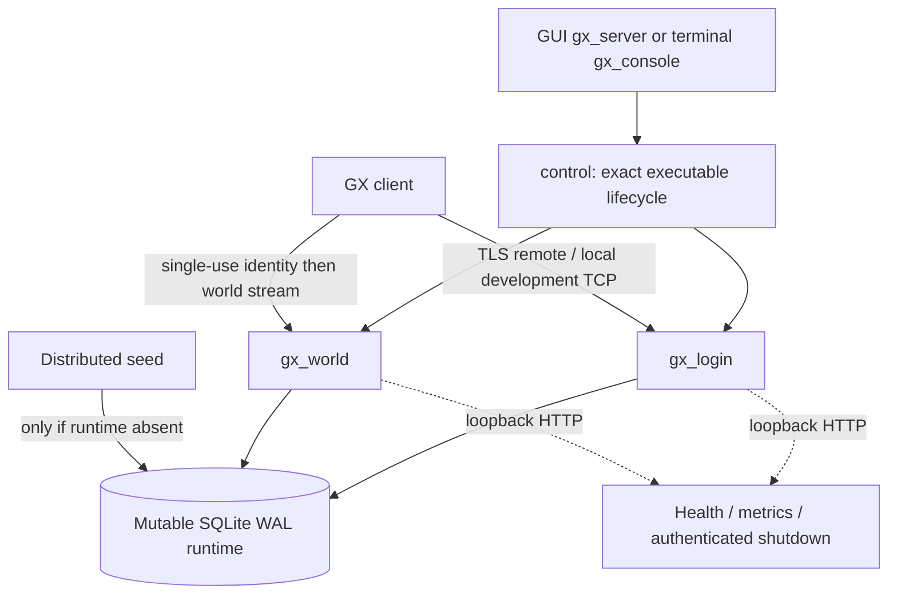

# GX Server architecture and lifecycle

GX Server is the authoritative server in the common GX repository and root Go
module. It is a modular Go application with SQLite as its primary production
storage. Gameplay remains faithful to the existing protocol and original rules;
modernization changes ownership, lifecycle, authentication and transaction safety.
The published seed and shared development accounts are intentional fixtures.

This page describes the development implementation after the November 2026
modernization. Released portables can predate it. Keep login, world and client
from matching builds; there is no supported mixed-version rolling upgrade.

## Reference map

- [Every server package and its contract](server-packages.md).
- [Infrastructure and command APIs](server-reference-infrastructure.md),
  [SQLite APIs](server-reference-storage.md), [world APIs](server-reference-world.md).
- [Wire framing and phases](server-protocol.md), [all 275 opcodes](server-opcodes.md)
  and [complete shared codec appendix](server-codecs.md).
- [SQLite transactions and recovery](server-storage.md),
  [security and observability](server-security.md), [operator guide](server-operations.md).

## Process and module structure



| Path | Role and persistence boundary |
|---|---|
| `server/cmd/gx_server` | Fyne one-button GUI; shares lifecycle implementation with console |
| `server/cmd/gx_console` | Terminal start/stop plus account/password and certificate commands |
| `server/cmd/gx_login` | Credential authentication, server list and login-to-world handoff |
| `server/cmd/gx_world` | Authoritative simulation and gameplay sessions |
| `server/cmd/gx_mapbuild` | Offline collision/navigation generation; not a live service |
| `server/internal` | Private runtime packages; all SQL is behind `db` |
| `server/ai` | Lua program/actor runtime and embedded/default encounter catalog |
| `server/data` | Shipped development seed, manifests and server content |
| `server/tools` | Storage, snapshot, content and packaging tools |
| `server/build` | Generated executables; not source assets |
| `runtime`, `.local`, `logs` | Mutable state/private overrides/operational output; outside Git |

No SQL daemon, queue broker or container orchestrator is required. One world
process owns one realm/database. Multiple independent installations need distinct
runtime databases, listener ports and working roots; they do not share live
in-memory simulation.

## Startup and shutdown

The controllers initialize a runtime only when absent, using a process lock and
validated seed. Direct cores initialize through the same database boundary.
Configuration is loaded/validated before listeners accept traffic. Invalid selected
AI scripts, data, schema checksums or required bootstrap state fail startup.

World startup opens SQLite, acquires the world lease, removes stale active-session
rows left by a previous owner, loads definitions/config/calendar/guilds/maps/relics,
then starts its listener, scheduler and diagnostics. The lease prevents a second
authoritative simulation from opening the same runtime concurrently. Login can
share that database using its separate process connection.

A shutdown request cancels the process context. Admission stops, pending socket IO
is interrupted, and socket handlers finish cleanup/persistence before the world
runtime and database close. `PRAGMA optimize` runs during bounded storage close.
Controllers first try authenticated loopback shutdown, including on Windows; they
wait up to 30 seconds before platform fallback. Matching includes executable
identity, not merely a process name. Native Windows execution was not part of the
local Linux modernization validation.

Closing the GUI leaves detached login/world running. Use Stop server or the
console shutdown command to stop those cores. Unexpected process termination does
not run cleanup; OS locks release and SQLite WAL recovery handles committed work.

## State ownership and concurrency

| Owner | Mutable state | Synchronization / rule |
|---|---|---|
| `realmState` | Shard/grid/player registries, instance mapping, identity counters, runtime reference, active account reservations | Dedicated registry/instance/runtime locks; counters atomic |
| `mapShard` | Actors, Lua execution, ground items and AI command queue | Shard lock; authoritative map-local access |
| `Session` | Selected character, inventory, buffs, timers, protocol phase, pending application operation | Serialized connection processing/session locking |
| `ConnectedPlayer` | Published player view, combat snapshots, bounded mailboxes and writer reference | Player mutex and bounded handoff methods |
| Social/trade domains | Party/raid/guild/trade membership and active operations | Explicit domain locks; ordered cross-session trade locking |
| SQLite transaction | Durable characters, items, balances, quests, guild state, account ownership | IMMEDIATE transactions, guarded before-state checks, one connection/process |
| World `Runtime` | Background timeline and cancellation | One serial scheduler; owned completion channel |

Registry identity/lifetime ownership does not authorize direct mutation of another
session's character. Cross-player effects go through snapshots/mailboxes or the
relevant coordinated domain operation. Account reservations and ground-item
claims release their registry/claim locks before SQL; slow storage must not hold
those locks. Inventory operations stage copies instead of copying mutexes.

The runtime is not a universal single-thread event loop. Connection handlers run
concurrently; background jobs execute serially. Per-shard and social locks remain
necessary. See the source API inventory before changing lock order or introducing
a callback across ownership boundaries.

## Background timeline

[StartSweeps](../../server/internal/world/sweeps.go) creates one cancellable runtime.
[Scheduler](../../server/internal/scheduler/scheduler.go) uses a 25 ms wake-up ticker,
executes due jobs serially, skips catch-up bursts and measures each job's duration
and lateness. It does not spawn one permanent goroutine per periodic task.

| Job | Cadence | Work |
|---|---|---|
| `combat` | 50 ms | Mob navigation/combat and queued actor actions; idle-world path remains bounded |
| `patrol` | 250 ms | NPC patrol movement |
| `relics` | 250 ms | Obelisk/relic state transitions |
| `respawns` | 1 s | Corpse removal and bounded mob respawn processing |
| `effects` | 1 s | Periodic damage and kill attribution |
| `killcount` | 1 s | Faction counters/blessing updates |
| `instances` | 1 s | Party-zone instance lifecycle |
| `items` | 2 s | Ground-item expiry |
| `guilds` | 5 s | Guild ranking maintenance |
| `storage` | 5 s | Storage metrics and exact-session account-release retries |

`Step(context, time)` permits deterministic scheduler tests. Duration/delay metrics
show overruns; the nominal cadence is not a guaranteed execution deadline under
load. Session input processing separately applies per-connection work budgets.

## Application transaction flow

```mermaid
sequenceDiagram
    participant C as Client
    participant S as Session adapter
    participant A as Application operation
    participant D as SQLite
    participant P as Published player state
    C->>S: opcode + explicit fields
    S->>S: framing, phase, budgets, field validation
    S->>A: validated intent
    A->>A: clone and stage inventory/character/packets
    A->>D: guarded atomic change
    alt stale state, validation or write failure
        D-->>A: rollback/error
        A-->>S: retain original state; no success publication
    else committed
        D-->>A: commit
        A->>P: publish new state/effects
        A-->>C: ordered confirmation packets
    end
```

`inventoryOperation` stages character/items/buffs and deferred packets/effects,
with a 256-packet publication budget. Shop/crafting/inventory adapters reuse this
boundary. Warehouse/guild-bank commits include both inventories and fees. Trade
coordinates both sessions and persists both sides before acknowledgement. Quest
completion includes rewards and completion together. Mall purchases include the
point debit, purchased items and audit records in the same transaction.

Ground loot has an exclusive claim; failed persistence releases the claim,
partial pickup preserves the remainder, and gold is credited durably before
removal. Item expiry skips a claimed entry. Reward accumulators are acknowledged
after commit and retain retryable amounts when a transaction fails.

## Failure and overload semantics

- Invalid protocol phase is refused before application dispatch. Malformed
  credential extensions fail decoding; invalid world identities close the socket.
- Input/rate violations or output overflow disconnect the offending connection;
  ordered authoritative output is never silently discarded to keep a socket alive.
- Combat mailboxes are capped; unresponsive recipients disconnect. Item-grant
  refusal uses the existing ground-loot fallback rather than deleting the item.
- Economic rewards use fixed accumulators with saturating bounds and existing
  per-event experience rounding. Quest counters retain acknowledgement/retry logic.
- AI commands have queue/weight/summon ceilings. Script faults disable the affected
  actor's AI; they do not grant unrestricted host access.
- Logical constraints/stale plans roll back. Unusable SQLite storage causes
  process cancellation; continuing an unsaved authoritative world is not supported.
- Ground loot and pending in-memory simulation events are ephemeral across crash.
  A durable acknowledgement does not make all transient simulation crash-persistent.

## Maintenance discipline

Add protocol changes to shared codecs, server adapters and client reducers, with
matching version behavior. Add atomic storage operations rather than independent
writes followed by compensation. Update the package/field documentation, run
`python3 tools/generate_server_reference.py`, and export the common Wiki with
`tools/publish_wiki.py`. Never publish runtime DBs, private certificates or personal
packet captures to explain a protocol field.

The modernization validates named invariants and fixtures; it is not a claim of
complete historical gameplay parity, a security certification or a maximum-player
benchmark. [Security/operations](server-security.md) describes the actual limits.
