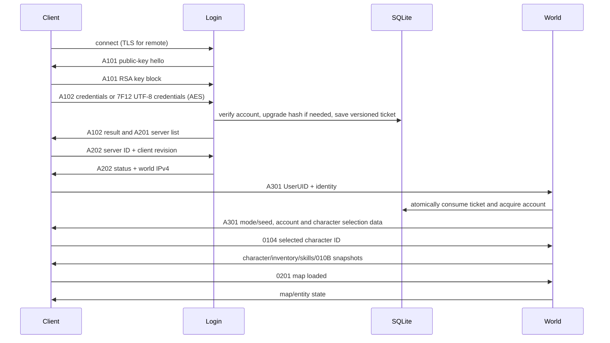

# Server wire protocol, session phases and packet reference

The common Wiki contains the [complete opcode catalog](server-opcodes.md),
fifteen family references and the [shared codec appendix](server-codecs.md).
Together they cover all current source opcode declarations and discovered literal
opcode routes/builders. They distinguish declarations from observed implementation
sites; this is not a catalog of every historical Shaiya revision.

## Frames, payloads and primitive types

TCP is a byte stream: a read can contain a fragment, one frame or several frames.
The outer frame has `length:u16 LE | opcode:u16 LE | body`, where length includes
itself. Minimum valid frame size is four bytes; the u16 limit is 65,535 bytes.
Frames are reconstructed before application decoding. TLS, when enabled, wraps
the existing stream and does not change these inner layouts.

The server `packet.Writer` emits the length and opcode. Client `proto.Writer`
emits opcode + body; client `netx.Conn.Write` adds the length. A `proto.Reader`
receives opcode + body and starts at offset two. An offset into a complete TCP
frame is therefore two bytes larger than the same payload offset. Do not add a
second length prefix to a packet already built by the server writer.

| Method / notation | Wire representation | Important behavior |
|---|---|---|
| `U8` / `u8` | 1 unsigned byte | Counts/enums are not Go-sized integers |
| `U16` / `u16` | 2 little-endian bytes | Also outer frame length and opcode |
| `U32` / `u32`, `I32` | 4 little-endian bytes | Signed interpretation only where I32 is used |
| `U64` | 8 little-endian bytes | Explicit width, no alignment padding |
| `F32` / `f32` | IEEE-754 bits in a little-endian u32 | Application validates finite/range values where required |
| `Bool` | One byte | Writer emits 0/1; reader interprets nonzero |
| `Count` | One byte on current writers | Semantic quantity type is uint16, but maximum is 255 |
| `Fixed(n)` / `FixedString` | Exactly n bytes | NUL-padded text; UTF-8/legacy ANSI decoding; string byte size matters |
| `Text` | u8 byte length including terminator, followed by text bytes | Used by compatible chat layouts; not a Go/JSON string |
| `Bytes(n)` / `Raw` | Exact byte sequence | No implicit length prefix; explicit preceding count/size governs it |
| Repeated rows | Explicit count + field sequence | Follow source loop and row fields, not in-memory struct size |

The first reader error sticks; subsequent primitive reads return zero and callers
must check `Err()`. A zero field is not proof that parsing succeeded. Conditional
failure/success replies often have different lengths. Packet names reused in both
directions do not imply identical request and response bodies.

### Item-stack compatibility

Current revision is `0x11122209` and uses native opcode/byte quantities. Maximum
stackability is one or 255 according to authoritative item definitions. The
retired wide-count reader recognizes opcodes in `0x4000..0x6FFF`, clears flag
`0x4000` to obtain the base opcode and reads `Count` as u16 for offline/compatible
fixtures. New writers do not emit that revision. Do not clear the flag from GX
`0x7Fxx` or login `0xAxxx` opcodes. See
[itemstack](../../internal/itemstack/stack.go) and
[reader/writer](../../internal/proto/rw.go).

## Transport and login progression

Remote listeners require TLS 1.3 unless the operator explicitly enables insecure
development transport. A configured CA/server name always requires TLS; invalid
certificates do not fall back. Legacy inner RSA/AES/XOR remain compatibility
mechanisms. [Security and TLS setup](server-security.md).



| Message | Exact body after opcode | Validation / outcome |
|---|---|---|
| S→C `0xA101` | unknown:u8, exponentLength:u8, modulusLength:u8, exponent bytes, modulus LE bytes | Current builder sends 64/128-byte RSA components |
| C→S `0xA101` | blockLength:u8, encrypted block | GX client serializer requires 128 bytes; server rejects short/zero blocks |
| C→S `0xA102` | user[32], password[16] | Legacy layout unchanged; current account validation allows 1–18 username bytes |
| C→S `0x7F12` | usernameLength:u8, passwordLength:u8, username bytes, password bytes | Exact total length; UTF-8, no NUL; username 1–18 bytes, password 1–128 bytes |
| S→C `0xA102` | result:u8; on success UserUID:u32, permission:u8, identity[16] | Long-password requests still receive this existing reply |
| S→C `0xA201` | count:u8; repeated id:u8, status:u8, users:u16, capacity:u16, name[32] | Current static advertisement is not a capacity benchmark or live connection gauge |
| C→S `0xA202` | serverID:u8, revision:u32 | Matching GX revision required |
| S→C `0xA202` | status:u8, IPv4[4] | World port comes from client configuration, not this reply |
| C→S `0xA301` | UserUID:u32, identity[16] | Minimum complete frame 24 bytes; ticket must be fresh, current and unused |
| S→C `0xA301` | status:u8, mode:u8, seed[16] | Controls subsequent world transport compatibility mode |

Login derives AES key/IV material with the legacy RSA/HMAC procedure. World
reuses the key and derives its IV from SHA-256(login IV)[:16]. Send and receive
streams are independent. The world hello reply establishes mode/seed; inbound
client handling changes at skill-bar `0x010B` and returns at logout `0x0107`.
AES versus expanded-table behavior is direction/mode-specific; see
[client connection state](../../internal/netx/conn.go),
[world framing](../../server/internal/world/session.go) and
[server cryptography](../../server/internal/crypto/crypto.go).

## Server session phases

[phaseAllows](../../server/internal/world/dispatch.go) runs before action dispatch.
Passing it is necessary but does not bypass per-handler role, range, ownership,
resource or content checks.

| Phase | Allowed client intent | Refusal behavior |
|---|---|---|
| Before world handshake | Initial `0xA301` identity only | Invalid/missing/replayed identity closes connection |
| No selected character | Faction choice, create/delete/restore/rename/select; ping/logout | Active-world actions are not dispatched |
| Awaiting map load | Map-enter acknowledgement `0x0201`, skill-bar state `0x010B`; ping/logout | Character management and other world actions refused |
| Active world | Implemented world routes; ping/logout | Character management and repeated map-enter refused |

Selecting a character requires loading its persisted inventory, skills, buffs,
quickbar, warehouse, points and quests before publishing a usable state. A failure
must not turn into an empty inventory or grant authority to overwrite persisted
state. Map changes return through the loading acknowledgement boundary.

Input budgets are validated before dispatching a batch. Fragment-only traffic
cannot repeatedly force heavy simulation or indefinitely starve regular ticks.
Economy commands have an additional validated per-second action budget. Current
limits and tuning knobs are in [security/limits](server-security.md).

## Family guide

| Reference | Authority and operation semantics |
|---|---|
| [Characters](protocol-characters.md) | Account-bound slot/name ownership, create+starter commit, soft delete/restore, selection snapshots and logout transport transition |
| [Actions](protocol-actions.md) | Inventory move/grant/remove, stat/skill changes, portals/gatekeepers, vehicle and appearance; movement destinations remain server validated |
| [Targets/world](protocol-targets.md) | Visibility-bound target state, effects, ground-item appearance/removal and world-time data; a client query cannot create an entity |
| [Combat/resources](protocol-combat.md) | Attack/cast intent, authoritative damage and HP/MP/SP, buffs/death/revival, equipment and speeds; target/reach/cost checks precede effects |
| [Monsters/NPCs](protocol-mobs.md) | Server actor enter/leave/motion, attacks/damage, HP/speech and NPC interaction IDs; definitions differ from live object IDs |
| [Shops/storage/forge](protocol-services.md) | NPC eligibility/range, exact item locations, original gold/material/chance rules and atomic storage/crafting publication |
| [Quests](protocol-quests.md) | Active and finished lists, offer/start/counters, reward choice/finish/abandon; reward and completion commit together, duplicate hand-in refused |
| [Exchange](protocol-trade.md) | Invitation, bilateral inventory/money offers, ready/confirmation and end; both sides commit before success, disconnect cancels unfinished intent |
| [Party/raid](protocol-groups.md) | Invitation/answer/roster, leader/division/subleader changes and live resource snapshots; member permissions apply |
| [Guilds](protocol-guilds.md) | Consensus creation/master fee, membership/ranks/notices, ranking and bank; cache/mirror/publication follow durable mutation |
| [Chat/admin](protocol-chat.md) | Length-bounded text and appropriate routing; native/extension command names do not confer GM authority |
| [Social/relic/PvP](protocol-social.md) | Friends/blocks, keep/portal ownership and rank rewards; account/character identity and eligible progression checked server-side |
| [Item Mall](protocol-mall.md) | Account points, priced product bundles, gifts and stored-gift claim; debit/items/audit atomic, request replay cannot duplicate a claim |
| [GX extensions](protocol-extensions.md) | Role-checked GM state, map catalogs/metadata, forge quotes, ladder/physics/mount state, target effects and bounded credentials |
| [Authentication](protocol-authentication.md) | Exact hello/credential/server-selection/world-handoff codecs and source adapters |

For each opcode, family pages link its declarations, receive cases, builders and
client reducers, then show the exact matched codec source with row types. Generic
helpers may appear for more than one opcode; the call-site opcode fixes their
variant. The appendix includes every shared codec file, including helpers or
inline/dynamic routes that static association cannot precisely classify.

## Packet examples and failure behavior

A plaintext example request to select character ID 1 is:

```
08 00 04 01 01 00 00 00
^^^^ ^^^^^ ^^^^^^^^^^^
len  0104  characterID u32
```

These are pre-encryption bytes, not a frame to inject unchanged into an encrypted
session. A client C→S exchange-add request carries bag:u8, slot:u8, count:u8 and
destination:u8 after `0x0A06`; the corresponding own-item and partner-item replies
have different layouts. Inspect [exchange codecs](protocol-trade.md) rather than
reusing the request struct as a response.

Unknown/unhandled opcodes do not automatically mutate state. Some legacy unsupported
routes are intentionally ignored, such as obsolete repair charges where GX has no
equipment wear. A declared constant or a client decoder is not proof that a server
handler exists. Rejected domain actions use the specific protocol's result/no-op
behavior; malformed frames and budget violations can close the connection.
A failed write must not emit a successful economy acknowledgement.

## Keeping the reference complete

```
source tools/go-env.sh
python3 tools/generate_server_reference.py
python3 tools/generate_server_reference.py --check
python3 tools/publish_wiki.py --checkout /path/to/Shaiya-GX.wiki --push
```

The generator uses Go ASTs, not text matching alone, to inventory definitions,
constructors and opcode cases. Platform source is parsed without cross-building.
It reads source only; no database or private packet captures are exported.
Update semantic guides whenever behavior changes, regenerate exact references,
and run the existing protocol/transaction tests. Coverage of declarations does
not prove correctness of all field interpretations or historical game behavior.
